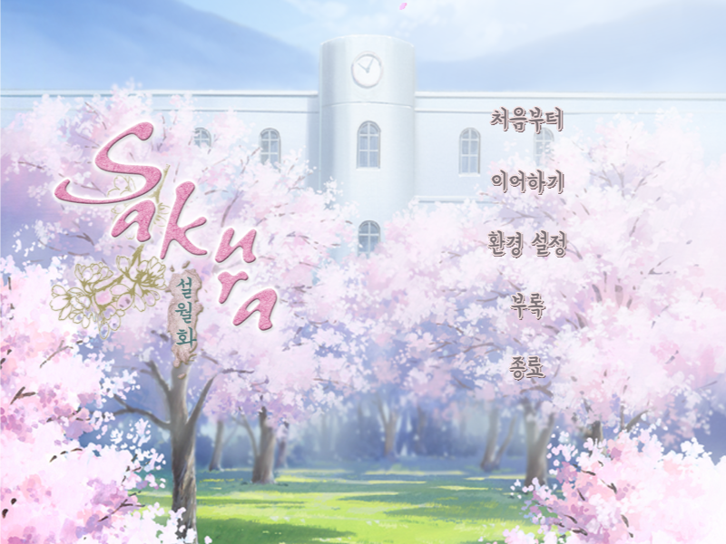
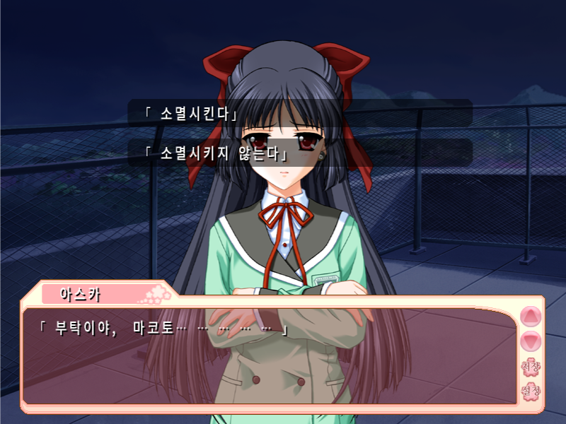
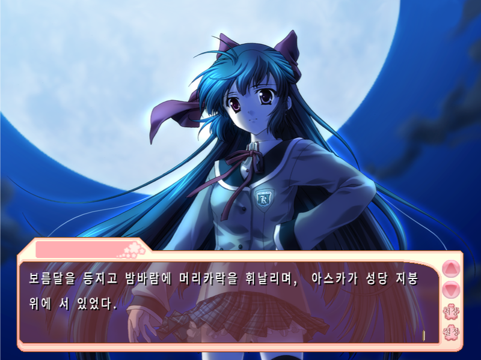
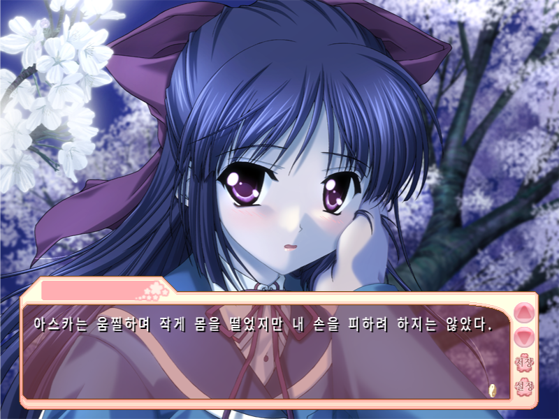
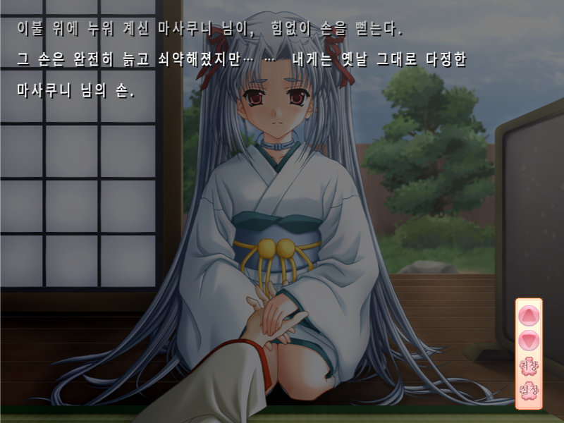
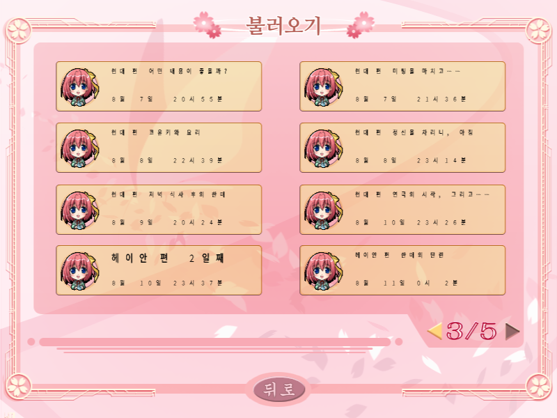

# SAKURA～설월화～ 한글패치

CIRCUS 의 「SAKURA～雪月華～」(DVD-ROM판) 한글패치의 배포 및 자동 업데이트 저장소입니다. **원본 게임이 필요한 패치**이며 게임 본편은 제공하지 않습니다.

[최신 설치 패치 받기](https://github.com/adios1579-lgtm/Sakura-Korean-Patch/releases/latest) · [설치/사용 설명](USER_GUIDE.md) · [문제 제보](https://github.com/adios1579-lgtm/Sakura-Korean-Patch/issues)

| | | |
|---|---|---|
|  |  |  |
|  |  |  |

- 본문 대사·지문·선택지 54,016행 전체 번역(2차 검수본)
- 타이틀·메뉴·설정·세이브 화면, 엔딩 스태프롤 등 화면 그림 230장 한글화
- 세이브/불러오기 칸의 장 제목과 날짜 한글화
- 로캘 에뮬레이터 없이 실행, 글꼴 설치 불필요(전용 글꼴 동봉)
- 실행할 때 DVD 를 넣지 않아도 됨(게임 자료가 하드디스크에 모두 설치돼 있어야 함)
- 게임 실행 시 업데이트 확인 및 동의 후 적용, 별도 수동 업데이트, 실패 시 복구
- 인터넷이 없어도 현재 버전으로 실행, 세이브·개인 설정 보존

## 설치

1. 본편을 설치합니다. 음성·음악·동영상까지 하드디스크에 모두 설치된 상태여야 합니다.
2. 릴리스의 `sakura-korean-patch-버전.zip` 을 받아, 게임을 끈 상태에서 **본편의 `SAKURA.EXE` 가 있는 폴더에 덮어 풉니다.**
3. **`SAKURA_한글판.exe`** 로 실행합니다.

GitHub 가 자동으로 만드는 `Source code` ZIP 은 게임 패치가 아닙니다.

## 알아 둘 점

- 전체 루트를 처음부터 끝까지 플레이하며 검수한 상태는 아닙니다. 오탈자나 어색한 곳은 [문제 제보](https://github.com/adios1579-lgtm/Sakura-Korean-Patch/issues)로 알려 주세요.
- 오류가 났을 때 뜨는 시스템 메시지 상자 몇 개는 일본어로 남아 있어 깨진 글자로 보일 수 있습니다.
- 엔딩 스태프롤의 일부 인명은 읽는 법을 확인하지 못해 추정으로 적었습니다.
- 지원 판본은 DVD-ROM판 하나입니다. 다른 판본에서는 실행기가 본편 파일이 다르다고 안내하고 멈춥니다.
- Windows 10 64비트 한국어 환경에서 만들고 확인했습니다.

업데이트 엔진 소스와 배포자 도구는 `src/`, `build_release.py`, `PUBLISHER_GUIDE.md` 에 있습니다. 저장소에는 토큰·세이브·원본 게임 자료를 넣지 않습니다.

게임 본편의 권리는 원작 권리자에게 있습니다. 이 한글패치의 제작자는 원작 제작사와 관계가 없습니다.
